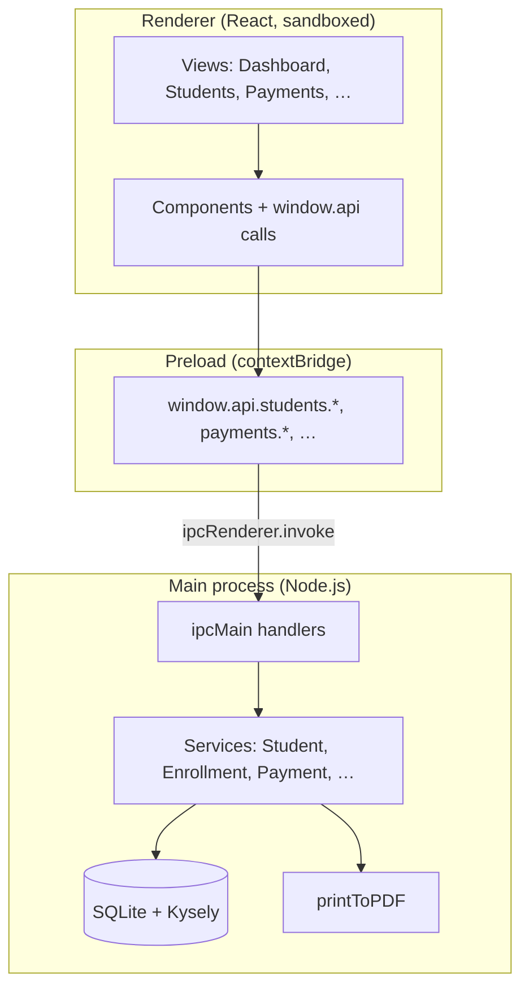

# Suivi Frais Scolaires

**School Fees & Treasury Management — Desktop Application and LAN PWA**

[](https://www.electronjs.org/)
[](https://react.dev/)
[](https://www.typescriptlang.org/)
[](https://www.sqlite.org/)
[](https://opensource.org/licenses/MIT)
[](https://github.com/nourkas-software/school-fees-monitoring-electronjs-app)

A production-oriented school application for tracking tuition and related fees, operating expenses, staff payroll, and consolidated treasury. Run it as a private, offline-first desktop application or as a multi-user web/PWA on the school’s local network.

Built with **Electron**, **React 19**, **TypeScript**, and **SQLite**, the app provides a complete fee-tracking system (students, enrollments, payments, balances, dashboards, printable receipts) with validated data entry, audit-friendly payment history, and a unified financial view across revenue and expenditure.

---

## Table of contents

- [Screenshots](#screenshots)
- [Why this application exists](#why-this-application-exists)
- [Key capabilities](#key-capabilities)
- [Application modules](#application-modules)
- [Technology stack](#technology-stack)
- [System requirements](#system-requirements)
- [Installation](#installation)
- [Running the application](#running-the-application)
- [Development workflow](#development-workflow)
- [Data management](#data-management)
- [Project structure](#project-structure)
- [Architecture](#architecture)
- [Security model](#security-model)
- [Testing](#testing)
- [Building for distribution](#building-for-distribution)
- [Roadmap](#roadmap)
- [Contributing](#contributing)
- [Contact](#contact)
- [License](#license)

---

## Screenshots

> Captured with the bundled **Émergence Ngaoundéré** demo profile (Paramètres → Clear data → Load demo data). The interface is fully bilingual — the screenshots below show the English mode.

### Dashboard

Enrollment and collection KPIs, consolidated treasury, collections by class, payment-status breakdown, and alerts.


### Enrollments

Enrollments for the active school year with registration numbers, class and section, expected fee, amount paid, balance, and payment status per row.


### Payments

Payment history for the selected enrollment, with receipt number, method, status, cancellation reason, and per-row print/cancel actions.


### Settings — class fees

Per-section class lists and annual fees. Francophone and Anglophone sections keep independent classes and pricing.


---

## Why this application exists

Manual, spreadsheet-based school fee systems work until they do not: formula breakage, concurrent edit conflicts, weak audit trails, and manual reconciliation across multiple tabs. This application addresses those limits while preserving familiar workflows for administrative staff.

| Manual bookkeeping pain point                         | Application response                                                                      |
| ----------------------------------------------------- | ----------------------------------------------------------------------------------------- |
| Accidental payment deletion                           | Payments are **never deleted**; cancellations use status + reason                         |
| One row per student conflates identity and enrollment | **Students** and **enrollments** are separate; one student can span multiple school years |
| Manual receipt numbering                              | Auto-generated receipt numbers with configurable prefix                                   |
| Fragmented view of cash position                      | **Treasury** consolidates tuition, expenses, and salaries                                 |
| Fragile print layouts                                 | PDF generation via Electron's native print engine                                         |
| No backup discipline                                  | One-click SQLite backup with overdue reminder                                             |

The target deployment model is **one computer, one school, fully offline**. SQLite runs locally under Electron's user-data directory; there is no cloud dependency for daily operations.

---

## Key capabilities

### Students & enrollments

- Student registry (matricule, identity, guardian contact, neighborhood)
- Unified registration: identity **and** class / section / year on the same form
- The **Élèves** sidebar always opens the year-scoped list (use **Ajouter un élève** or `Ctrl/Cmd+Shift+E` for the form)
- Per–school-year enrollment with bilingual class labels, registration number, and **fee snapshot**
- Balance calculation per enrollment (expected fee − total paid)
- Payment status derived from balance (Paid, Partial, Unpaid, Overpaid)
- Soft-archive (`Archivé`) without deleting history

### Payments (tuition & fees)

- Payment journal linked to enrollments
- Categories, terms, installment numbers, payment mode, cashier, notes
- Auto-generated receipt numbers
- PDF payment receipts (bilingual FR/EN document text)
- Cancellation with mandatory reason — original row preserved

### Expenses

- Operational expense tracking (supplies, maintenance, utilities, etc.)
- Category filters, reference numbers, supplier field
- PDF expense register export

### Staff & payroll

- Staff member records with monthly salary baseline
- Salary payment journal (same cancel-not-delete pattern as tuition)
- PDF salary receipts
- Monthly balance overview per staff member

### Dashboard & analytics

- KPI cards: enrolled students, collected amounts, outstanding balance, recovery rate
- Treasury row: revenue, expenses, salaries, net cash position
- Charts: monthly collections, payment status, class balances, treasury trend
- Side panels: largest overdue balances and most recent payments
- Alerts: overdue backup, unpaid staff, expense budget exceeded
- Amounts use a shared currency helper (`shared/currency.ts`) and the **Devise** setting
- Data scoped to the selected school year

### Reports & printing

- Per-student statement PDF (payment history + balance)
- Class roster PDF
- Consolidated financial report PDF
- Documents use school identity from **Paramètres** (name, logo, address, director)
- Print language follows **document language mode** (French, English, or bilingual)

### Operations

- **School year closeout** — copy fees and re-enroll active students into the next year without losing history
- **Global search** (`Ctrl/Cmd+K`) — jump to any student from anywhere
- **Overdue reminders** — outstanding balances with WhatsApp / clipboard message templates
- **Database backup & restore** — export a `.sqlite` snapshot, optional automatic local backups, restore from a backup file (app restarts)
- **In-app help** — getting-started guide for each screen

### Settings (Paramètres)

- **Infos école** — name, logo, address, contacts, director, ministry headers, currency, receipt prefixes
- **Tarifs par classe** — bilingual class levels (Francophone / Anglophone) and annual fees
- **Catégories & caissiers** — payment categories, expense categories, cashiers
- **Options avancées** — UI language, document language, receipt paper format, salary mode, expense approval, backup interval, table page size
- **Clôture d'année** — year-end closeout wizard
- **Vider les données** — selective wipe of operational records **and** configuration (identity, logo, year, classes, fees, categories, cashiers, advanced options)
- **Charger les données de démonstration** — bundled demo profile (classes, students, payments, expenses, staff), including from a packaged `.exe`. Optional: keep the current school identity and advanced options

> **UI language:** French and English, switchable in the header (persisted as `ui_language`). Printed documents follow **document language mode**.

---

## Application modules

The sidebar navigation maps to these functional areas:

| Module            | French label  | Purpose                                                             |
| ----------------- | ------------- | ------------------------------------------------------------------- |
| Dashboard         | Accueil       | KPIs, treasury, charts, alerts, overdue / recent payments           |
| Students          | Élèves        | Year-scoped list, filters, unified registration, detail             |
| Enrollments       | Inscriptions  | Year enrollment, class assignment, balances                         |
| Payments          | Paiements     | Tuition payment entry and history                                   |
| Expenses          | Dépenses      | School operating expenses                                           |
| Staff             | Personnel     | Staff records and salary payments                                   |
| Student report    | Rapport élève | Individual statement preview + PDF                                  |
| Financial reports | Finances      | Treasury summary, exports                                           |
| Settings          | Paramètres    | Identity, fees, categories, advanced options, closeout, demo / wipe |
| Help              | Aide          | In-app getting-started guide                                        |

---

## Technology stack

|                                                                                                         | Technology                                                                              | Role                                         |
| ------------------------------------------------------------------------------------------------------- | --------------------------------------------------------------------------------------- | -------------------------------------------- |
|          | **[Electron](https://www.electronjs.org/)** 43                                          | Cross-platform window, PDF, native dialogs   |
|    | **[Electron Forge](https://www.electronforge.io/)** + **[Vite](https://vitejs.dev/)** 5 | Dev server, bundling, installers             |
|                | **React** 19 + **TypeScript**                                                           | Component-based interface                    |
|   | **Tailwind CSS** v3                                                                     | Glass-over-gradient theme, responsive layout |
|            | **Radix UI** (Popover), lucide-react icons                                              | Accessible primitives                        |
|              | **Recharts**                                                                            | Dashboard visualizations                     |
|           | **date-fns**, react-day-picker v10                                                      | Locale-aware display, ISO storage            |
|            | **i18next**                                                                             | French / English UI                          |
|               | **Sonner**                                                                              | Toast feedback                               |
|              | **SQLite** via `better-sqlite3`                                                         | Local persistence, WAL mode                  |
|              | **[Kysely](https://kysely.dev/)**                                                       | Typed SQL, migrations                        |
|               | `contextBridge` + `ipcMain.handle`                                                      | Secure main ↔ renderer bridge                |
|      | `webContents.printToPDF`                                                                | No headless Chromium dependency              |
|              | **Vitest**                                                                              | Service-layer tests                          |
|  | **Playwright** (Electron)                                                               | Smoke user journeys                          |

---

## System requirements

### Development

- **Node.js** 18 or later (LTS recommended)
- **npm** 9+
- macOS, Windows, or Linux
- Native build toolchain for `better-sqlite3` (Xcode CLT on macOS, Visual Studio Build Tools on Windows)

### Runtime (end users)

- macOS 11+, Windows 10+, or modern Linux desktop
- ~200 MB disk for application; database size grows with school data
- No network required for normal use

---

## Installation

Clone the repository and install dependencies from the `app/` directory:

```bash
# SSH
git clone git@github.com:nourkas-software/school-fees-monitoring-electronjs-app.git

# or HTTPS
git clone https://github.com/nourkas-software/school-fees-monitoring-electronjs-app.git

cd school-fees-monitoring-electronjs-app/app
npm install
```

If Electron fails to load the native SQLite module after upgrading Electron or Node:

```bash
npm run rebuild
```

---

## Running the application

### Development mode

```bash
npm start
```

This runs Electron Forge with Vite dev servers for the renderer and watch builds for the main and preload processes.

### Development with DevTools

```bash
npm run start:debug
```

Opens detached DevTools (`ELECTRON_OPEN_DEVTOOLS=1`).

### Clean restart (recommended when things break)

Hot reload updates the **renderer** immediately but can leave the **main process** stale, which surfaces as errors like `No handler registered for 'print:…'`. Always use a full restart after pulling main-process changes:

```bash
npm run restart
```

Equivalent to `npm run dev:clean && npm start` — kills stale Electron/Vite processes, then starts fresh.

During dev, you can also type **`rs`** in the terminal where Forge is running to restart the Electron process.

---

## Web/PWA on the school LAN

The web client reuses the existing typed business operations and SQLite database through an authenticated HTTP API. Build and run the server with Node.js dependencies installed:

```bash
npm ci
WEB_ADMIN_USERNAME=admin \
WEB_ADMIN_PASSWORD='choose-a-long-unique-password' \
npm run web:server
```

The first start creates the administrator account if the database has no web users. Use a unique password of 12 or more characters (maximum 64 UTF-8 bytes); the password is stored as a salted scrypt hash. Later, an administrator can add or disable named staff/admin accounts from **Comptes** in the web interface. Staff accounts can operate on school records; only administrators can manage users, settings, class fees, closeouts, destructive cleanup, deletion and backups.

`web:server` builds the PWA and starts the Electron main process in headless HTTP-server mode. By default it listens only on `127.0.0.1:4173`. To make it available to other devices, put it behind an HTTPS reverse proxy and configure the LAN name/IP allowed by that proxy:

```bash
export WEB_HOST=0.0.0.0
export WEB_PORT=4173
export WEB_COOKIE_SECURE=1
export WEB_ALLOWED_HOSTS=fees.school.lan
WEB_ADMIN_USERNAME=admin WEB_ADMIN_PASSWORD='choose-a-long-unique-password' npm run web:server
```

The reverse proxy must preserve the browser `Host` header and use HTTPS. Do not expose port 4173 directly to the LAN or Internet; `WEB_COOKIE_SECURE=1` requires HTTPS at the browser. Allow only the intended host name(s) in `WEB_ALLOWED_HOSTS` to prevent DNS-rebinding access. The API uses same-origin checks, `HttpOnly`/`SameSite=Strict` cookies, 8-hour in-memory sessions, login throttling, and an admin-only user-management API. Restarting the server logs everyone out.

Install the PWA from the browser’s install action after opening the HTTPS school URL. `npm run web:dev`, `npm run web:build`, and `npm run web:preview` are available for frontend development and preview. The service worker caches static interface assets only: API replies and school records are never cached, and records require a live connection to the school server.

The packaged app includes the built PWA (`npm run package`/`npm run make` build it automatically). Set `WEB_SERVER=1` in the packaged app’s environment to run its HTTP server without opening the desktop window. To migrate an existing desktop installation, stop it, make a verified SQLite backup, then place a copy at the server host’s `complex-scolaire.sqlite` user-data path before first start; database migrations run automatically. Backups initiated in the PWA are downloaded to the browser and retained in the server’s backup directory. Restore is administrator-only and restarts the server. Web spreadsheet exports are downloaded as Excel-compatible CSV; printing uses the browser print dialog.

---

## Development workflow

### Code layout conventions

- **Renderer** never imports Node modules or touches the filesystem
- All persistence goes through `window.api.*` (see `src/preload.ts`)
- Business logic lives in `src/main/services/`
- Code used by both main and renderer lives in `shared/` (currency, wipe selection, receipt codes)
- Shared renderer types: `src/lib/types.ts`
- UI primitives: `src/components/ui/`
- Visual theme rules: `.github/instructions/ui-style.instructions.md`

### Linting & formatting

```bash
npm run lint
npm run format        # apply Prettier
npm run format:check  # CI-style check
```

### Useful scripts

| Script                               | Description                                |
| ------------------------------------ | ------------------------------------------ |
| `npm start`                          | Launch dev app                             |
| `npm run restart`                    | Kill stale processes + start               |
| `npm run dev:clean`                  | Kill stale Electron/Vite only              |
| `npm test`                           | Vitest unit tests                          |
| `npm run test:e2e`                   | Playwright E2E                             |
| `npm run package`                    | Package without installers                 |
| `npm run make`                       | Build platform installers                  |
| `npm run check`                      | Typecheck + lint + unit tests              |
| `npm run seed:fixtures -- [--reset]` | Seed synthetic demo data (CLI)             |
| `npm run seed:profile -- <id>`       | Apply a school profile from `profiles/`    |
| `npm run import:excel`               | Import a legacy Excel workbook             |
| `npm run web:dev`                    | Run the PWA shell locally                  |
| `npm run web:build`                  | Build the PWA shell into `dist/web/`       |
| `npm run web:server`                 | Build the PWA and start the LAN API/server |

---

## Data management

### Database location

The SQLite file is stored in Electron's user-data directory:

| Platform | Typical path                                                             |
| -------- | ------------------------------------------------------------------------ |
| macOS    | `~/Library/Application Support/complex-scolaire/complex-scolaire.sqlite` |
| Windows  | `%APPDATA%/complex-scolaire/complex-scolaire.sqlite`                     |
| Linux    | `~/.config/complex-scolaire/complex-scolaire.sqlite`                     |

WAL mode is enabled. Foreign keys are enforced. Migrations run automatically on startup.

### Seed demo data

**From the packaged app (`.exe` / `.app`):** **Paramètres → Vider les données → Charger les données de démonstration**.  
Leave **Conserver l'identité et les options actuelles** checked to keep the school name, logo, year, and advanced options; uncheck it to load the demo school identity as well.

**From a development checkout:**

```bash
npm run seed:fixtures -- --reset
```

Then reload the app window (`Cmd/Ctrl+R`). The script can run while the dev app is open; WAL mode allows concurrent access.

School-specific packs live in `profiles/` (`demo`, `template`, `emergence`, …) and can be applied with `npm run seed:profile -- <id>`.

### Clear selected data

**Paramètres → Vider les données** can wipe operational records (payments, expenses, salaries, enrollments, students, staff, audit) and, if ticked, configuration (identity, logo, school year, classes, fees, categories, cashiers, advanced options). Unticked items stay.

### Backup & restore

Use **Paramètres → Options avancées** (or the dashboard reminder) to export a `.sqlite` copy. Automatic local backups can be enabled there. **Restore** replaces the current database from a chosen backup and restarts the app.

---

## Project structure

```
app/
├── src/
│   ├── main.ts                 # Electron bootstrap, window lifecycle, IPC ensure
│   ├── preload.ts              # contextBridge API (window.api)
│   ├── App.tsx                 # Shell: sidebar, school year, routing
│   ├── index.css               # Theme tokens, global styles
│   ├── locales/                # fr.json / en.json
│   ├── main/
│   │   ├── db/
│   │   │   ├── connection.ts   # SQLite + Kysely setup
│   │   │   ├── migrations/     # Versioned schema migrations
│   │   │   └── schema-types.ts
│   │   └── services/           # Business logic + ipc.ts
│   ├── views/                  # Screen-level React components
│   ├── components/             # UI primitives, layout, dashboard, reports
│   ├── hooks/
│   └── lib/                    # dates, format wrappers, types
├── shared/                     # Main + renderer: currency, next-code, wipe selection
├── profiles/                   # School packs (demo, template, emergence, …)
├── scripts/
│   ├── seed-fixtures.ts        # CLI demo seed
│   ├── seed-profile.ts         # Apply a profile JSON
│   ├── import-excel.ts
│   └── dev-clean.sh            # Kill stale dev processes
├── e2e/                        # Playwright tests
├── assets/icons/               # App icon (packaged + window)
├── assets/screenshots/         # README screenshots
├── forge.config.ts             # Electron Forge makers + plugins
├── vite.main.config.ts
├── vite.preload.config.ts
└── vite.renderer.config.ts
```

---

## Architecture



### IPC surface (summary)

The preload exposes typed namespaces: `students`, `enrollments`, `payments`, `expenses`, `staff`, `reports`, `treasury`, `settings`, `print`, `backup`, `dataCleanup`, `reference`, `system`, and others. Each maps to `ipcMain.handle('domain:action', …)` registered in `src/main/services/ipc.ts`.

Handlers are re-registered after renderer reloads to stay consistent during development.

---

## Security model

This application follows Electron security baseline practices:

| Control           | Setting                                                        |
| ----------------- | -------------------------------------------------------------- |
| Context isolation | Enabled                                                        |
| Node integration  | Disabled in renderer                                           |
| Sandbox           | Enabled                                                        |
| SQL injection     | Prevented via Kysely parameterized queries                     |
| External URLs     | `shell.openExternal` restricted to `https:`, `mailto:`, `tel:` |

The renderer **cannot** read or write the database file directly. All file operations (backup, logo pick, PDF save dialog) run in the main process.

---

## Testing

### Unit tests

```bash
npm test
```

Covers service-layer logic (balances, reports, date helpers, currency formatting, data cleanup, fixtures, etc.) via Vitest.

### End-to-end tests

```bash
npm run test:e2e
```

Playwright drives the packaged Electron app through critical paths (launch, navigation, student registration, payments, expenses, staff). Run `npm run package` at least once before the suite so `.vite/build/main.js` exists.

---

## Building for distribution

All commands below are run from the **`app/`** directory. Installers are written to **`app/out/`**.

Because the app uses the native **`better-sqlite3`** module, build on the **target OS** (or use a CI runner for that OS). Cross-compiling Windows `.exe` from macOS, or macOS `.app` from Windows, is not supported out of the box.

### Quick check before building

```bash
npm run check          # typecheck + lint + unit tests
npm run rebuild        # if Electron/Node was upgraded
```

### Package only (no installer)

Creates an unpacked app folder — useful for smoke tests and E2E:

```bash
npm run package
```

Output example: `out/complex-scolaire-darwin-arm64/complex-scolaire.app`

### Windows (`.exe` installer)

Run on **Windows 10+** (Visual Studio Build Tools required for native modules):

```bash
npm run make
```

Or explicitly:

```bash
npm run make -- --platform=win32 --arch=x64
```

**Output:** `out/make/squirrel.windows/x64/`

- **`complex-scolaire-1.0.0 Setup.exe`** — installer to distribute
- `complex-scolaire-1.0.0-full.nupkg`, `RELEASES` — Squirrel update artifacts

> **The Setup.exe installer can only be assembled on Windows** (the Squirrel
> maker needs Mono + Wine elsewhere). Building the win32 target from
> macOS/Linux instead produces a **portable ZIP**
> (`out/make/zip/win32/x64/complex-scolaire-win32-x64-1.0.0.zip`): unzip it
> on the Windows PC and run `complex-scolaire.exe` inside — no installation
> step. For a real installer, build on a Windows machine or use the
> **Installers** GitHub Actions workflow
> (`.github/workflows/installers.yml`), which runs `npm run make` on a
> Windows runner and uploads the `.exe` as an artifact.

### macOS (`.zip`)

Run on **macOS 11+**:

```bash
npm run make
```

Apple Silicon (M1/M2/M3):

```bash
npm run make -- --platform=darwin --arch=arm64
```

Intel Mac:

```bash
npm run make -- --platform=darwin --arch=x64
```

**Output:** `out/make/zip/darwin/<arch>/`

- **`complex-scolaire-darwin-<arch>-1.0.0.zip`** — unzip, then open **`complex-scolaire.app`**

> macOS Gatekeeper may block unsigned apps on first launch. Right-click → **Open**, or sign/notarize before wide distribution (planned).

### Linux (`.deb` and `.rpm`)

Run on a **Linux desktop** with build tools installed:

```bash
npm run make
```

Or explicitly:

```bash
npm run make -- --platform=linux --arch=x64
```

**Output:**

- **Debian / Ubuntu:** `out/make/deb/x64/complex-scolaire_1.0.0_amd64.deb`
- **Fedora / RHEL:** `out/make/rpm/x64/complex-scolaire-1.0.0.x86_64.rpm`

Install examples:

```bash
sudo dpkg -i out/make/deb/x64/complex-scolaire_1.0.0_amd64.deb
# or
sudo rpm -i out/make/rpm/x64/complex-scolaire-1.0.0.x86_64.rpm
```

### Summary

| OS                         | Build on        | Command (from `app/`)                            | Artifact                                              |
| -------------------------- | --------------- | ------------------------------------------------ | ----------------------------------------------------- |
| **Windows (installer)**    | Windows (or CI) | `npm run make -- --platform=win32 --arch=x64`    | `out/make/squirrel.windows/x64/* Setup.exe`           |
| **Windows (portable ZIP)** | any OS          | `npm run make -- --platform=win32 --arch=x64`    | `out/make/zip/win32/x64/*.zip`                        |
| **macOS (Apple Silicon)**  | macOS           | `npm run make -- --platform=darwin --arch=arm64` | `out/make/zip/darwin/arm64/*.zip`                     |
| **macOS (Intel)**          | macOS           | `npm run make -- --platform=darwin --arch=x64`   | `out/make/zip/darwin/x64/*.zip`                       |
| **Linux**                  | Linux (or CI)   | `npm run make -- --platform=linux --arch=x64`    | `out/make/deb/x64/*.deb` and `out/make/rpm/x64/*.rpm` |

Makers are configured in `forge.config.ts` (Squirrel, ZIP, DEB, RPM). The **Installers** workflow (`.github/workflows/installers.yml`) builds all three on native runners — trigger it manually from the Actions tab or push a `v*` tag.

> **Note:** Signed installers and store-ready packaging metadata are planned for a future release. Update `productName` and icons in `package.json` / `assets/icons/` before a public release.

---

## Roadmap

### Delivered

Data layer, students/payments, dashboard, PDF reports, settings, expenses, staff, treasury, bilingual UI, school-agnostic branding, profile seeders, backup **and restore**, in-app help, selective data wipe, in-app demo fixtures (including packaged builds), shared currency formatting.

### Planned

- **Signed installers** and store-ready packaging metadata
- Payment-modes CRUD, per-category expense budgets, daily cash register
- Attachment storage on payments and expenses

---

## Contributing

Contributions are welcome: bug fixes, tests, documentation, translations, and new features.

Repository: <https://github.com/nourkas-software/school-fees-monitoring-electronjs-app>

1. Fork the repository
2. Create a feature branch from `main`
3. Run `npm run lint`, `npm test`, and `npm run format:check` before opening a PR
4. Describe user-visible changes and link related documentation updates

For large features, open an issue first to align with the roadmap.

---

## Contact

Custom deployments, branding, training, or feature development for your school:

**Mohamed Nourdine**  
Email: [mohamednjikam25@hotmail.com](mailto:mohamednjikam25@hotmail.com)

---

## License

MIT — Copyright © Mohamed Nourdine. See `package.json` for license metadata.
